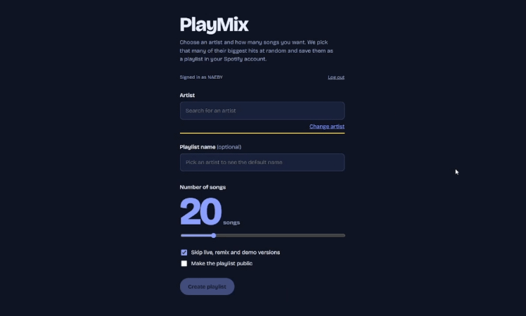

# PlayMix

A Flask web app that builds a Spotify playlist from an artist's biggest songs. Pick an artist, choose how many songs (1 to 100), optionally name the playlist, and the app saves a playlist of randomly chosen hits to your Spotify account.



**Live demo:** https://playmix-fo3r.onrender.com/

## Live demo

The app is deployed on Render's free plan. Two things to know before you try it:

- **Limited login access.** Spotify's development mode only lets accounts that I've added by email sign in (up to 5). If you can't log in, the GIF above shows the full flow.
- **Slow first load.** The free plan sleeps when idle, so the first visit after a quiet period can take about a minute.

You can also run it yourself, see [Run it locally](#run-it-locally).

## How it works

- **Spotify OAuth 2.0 (authorization code flow)** with a CSRF `state` check. Tokens are encrypted, stored per user in the session cookie, and refreshed automatically.
- **Hit ranking:** Spotify removed its "artist top tracks" endpoint for new apps in 2026, so play counts come from the Last.fm API. If Last.fm is unavailable or no key is set, the app falls back to Spotify search order.
- **Weighted random selection:** bigger hits are more likely to be picked, with dampening so the top few songs don't appear in every playlist.
- **Clean-up:** optionally skips live, remix, acoustic, demo and karaoke versions, and collapses duplicates such as remasters.
- **Speed:** track lookups run concurrently in a thread pool, and Last.fm and Spotify lookups are cached in memory with a TTL.
- **Resilience:** automatic retry with backoff on Spotify rate limits, input validation, readable error messages in the UI, and a `/health` endpoint.

## Security

- **Encrypted login tokens:** the Spotify token is encrypted (Fernet) before it is stored in the session cookie, on top of the cookie being signed, `HttpOnly`, `Secure` and `SameSite=Lax` (with the `__Host-` prefix in production).
- **OAuth hardening:** authorization code flow with a random `state` check, minimal scopes (playlist modification only), and logout via POST.
- **Security headers:** a strict Content-Security-Policy with a per-request nonce, plus HSTS, `X-Frame-Options`, `X-Content-Type-Options`, `Referrer-Policy` and `Permissions-Policy`.
- **Request checks:** cross-site POST requests are rejected (`Origin` / `Sec-Fetch-Site`), input is validated, and the artist name is always fetched from Spotify rather than trusted from the browser.
- **Abuse protection:** per-IP rate limits on the search and playlist endpoints, and a small request-size cap.
- **Safe failure:** in production the app refuses to start if secrets are missing or the redirect URI is not https, and unexpected errors return a generic message while details stay in the server logs.
- **Supply chain:** Dependabot updates and a `pip-audit` check run in CI.

## Run it locally

1. Create an app at https://developer.spotify.com/dashboard and add `http://127.0.0.1:5000/callback` as a redirect URI. Spotify requires a Premium account for app owners.
2. Get a free Last.fm API key at https://www.last.fm/api.
3. Copy `.env.example` to `.env` and fill it in.
4. Install and run:

```bash
pip install -r requirements-dev.txt
python app.py
```

Open http://127.0.0.1:5000 (use `127.0.0.1`, not `localhost`, so the session cookie matches the redirect URI).

## Tests

```bash
pytest -q
```

42 tests mock Spotify and Last.fm, and run on every push through GitHub Actions on Python 3.12 and 3.14.

## Deploy

The live version runs on [Render](https://render.com) as a Python web service connected to this repo, and redeploys on every push to `main`.

- **Build command:** `pip install -r requirements.txt`
- **Start command:** `gunicorn app:app`
- **Environment variables:** `SPOTIPY_CLIENT_ID`, `SPOTIPY_CLIENT_SECRET`, `SPOTIPY_REDIRECT_URI` (your site address plus `/callback`, which must also be added in the Spotify dashboard), `LASTFM_API_KEY`, `FLASK_SECRET_KEY`, and `PRODUCTION=1` (enables strict cookies and startup checks).

With more than one worker, replace the in-memory cache in `playlist.py` and the in-memory rate-limit storage in `app.py` with Redis.

## Limitations

- Spotify development mode allows only 5 authorized users per app, and search returns at most 10 results per request.
- The app looks at an artist's top 50 to 200 tracks, so smaller artists may return fewer songs than requested.
- The free Render plan sleeps when idle, and the cache and rate limits live in memory, so they reset on restart.
